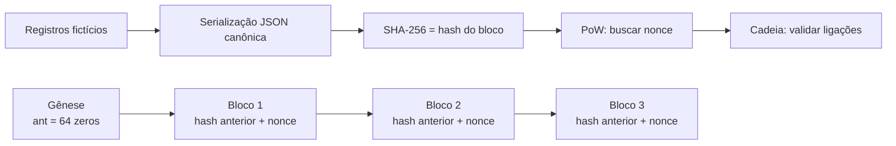

# Blockchain didática (projeto bônus – Introdução à Criptografia)

Blockchain **local e exclusivamente educacional** para registrar eventos acadêmicos **fictícios**
(ex.: `aluno-017`). Não é criptomoeda, não é distribuída e não deve ser usada em produção.

## Requisitos
Python 3.10 ou mais recente. Somente biblioteca padrão (nenhum pacote a instalar).

## Instalação passo a passo
1. **Instale o Python 3.10+** (https://www.python.org/downloads/). No Windows, marque *Add python.exe to PATH*.
2. **Confira a versão:**
   ```
   python --version
   ```
3. **Obtenha os arquivos** e abra um terminal na pasta do projeto:
   ```
   cd caminho/para/blockchain_didatica
   ```
4. **Módulos do projeto (nada a instalar):** `hashlib`, `json`, `dataclasses`, `copy`, `time`,
   `typing`, `unittest` e `subprocess` fazem parte da biblioteca padrão do Python.
5. **(Opcional) Só para regenerar o PDF do relatório**, instale o `reportlab`:
   ```
   python -m venv .venv
   .venv\Scripts\activate          # Windows  (Linux/macOS: source .venv/bin/activate)
   python -m pip install reportlab
   python gerar_relatorio.py
   ```
   O `relatorio.pdf` já vem pronto; este passo não é necessário para rodar o código nem os testes.
6. **Verifique a instalação:**
   ```
   python -m unittest -v
   ```
   Todos os 30 testes devem terminar com `OK`.

## Arquitetura

Cada bloco guarda o hash do anterior; alterar qualquer bloco muda seu hash e quebra o elo seguinte.

## Bibliotecas e funções usadas (todas da biblioteca padrão)
| Item | Para que serve neste projeto |
|---|---|
| `dataclasses.dataclass` | Gera construtor e métodos básicos da classe `Bloco`. |
| `json.dumps` (`sort_keys`, `separators`, `ensure_ascii=False`, `allow_nan=False`) | Serialização canônica: ordena chaves, remove espaços, preserva Unicode e rejeita NaN/infinito. |
| `str.encode("utf-8")` | Converte o texto canônico em bytes, entrada do SHA-256. |
| `hashlib.sha256` / `hexdigest()` | Calcula o hash e o devolve como 64 dígitos hexadecimais. |
| `time.time` | Timestamp do bloco (pode ser injetado nos testes para ser reproduzível). |
| `time.perf_counter` | Mede a duração da mineração na comparação de dificuldades. |
| `str.startswith("0" * dificuldade)` | Verifica a regra da prova de trabalho. |
| `copy.deepcopy` | Copia os registros recebidos, evitando mutações externas silenciosas. |
| `typing.Any` | Anotações de tipo. |
| `unittest` | Testes automatizados (`assertEqual`, `assertTrue`, `assertRaises`, `subTest`). |
| `subprocess` | Usado no `demo.py` para executar os testes. |

`secrets` não é usado: o nonce é um contador público (0, 1, 2, ...), não um segredo.

## Arquivos
| Arquivo | Conteúdo |
|---|---|
| `blockchain.py` | `serializar_canonico`, `criar_registro`, `Bloco` (hash e mineração), `Blockchain` (gênese, inclusão, `validar` e `diagnosticar`) |
| `demo.py` | Demonstração: cadeia íntegra, adulteração, remineração parcial, reconstrução total, comparação de dificuldades, testes |
| `test_blockchain.py` | 30 testes automatizados cobrindo os 12 requisitos do tópico 5 |
| `relatorio.pdf` | Relatório técnico (gerado a partir de `gerar_relatorio.py`) |

## Como executar
```
python demo.py                 # demonstração completa (já executa os testes ao final)
python -m unittest -v          # somente os testes
```

## Modelo de dados
Bloco: `indice`, `timestamp`, `registros`, `hash_anterior`, `nonce`, `dificuldade`, `hash`.
O hash é o SHA-256 do JSON canônico (`sort_keys`, separadores `,` `:`, `ensure_ascii=False`,
`allow_nan=False`, UTF-8) de todos os campos **exceto** `hash`.
Gênese: índice 0, timestamp 0, hash anterior = 64 zeros. Dificuldade aceita: inteiros de 1 a 6
(use 1 a 3 nas execuções).

## Limitações
Uma lista local não tem consenso, rede, identidade ou assinatura: quem controla o arquivo pode
refazer toda a cadeia e ela voltará a ser válida. Só há *evidência de adulteração* se houver uma
âncora/cópia externa confiável. Hash não esconde conteúdo (não é cifra).

## Fontes e ferramentas declaradas
- Enunciado do projeto bônus (`aluno.pdf`) e documentação oficial do Python (`hashlib`, `json`, `unittest`, `dataclasses`).
- **Uso de IA declarado:** o código, os testes, o README e o relatório foram elaborados com auxílio de
  um assistente de IA (Antigravity). [Integrantes: revisem, entendam e ajustem antes da entrega.]
- Nenhuma biblioteca pronta de blockchain ou código de outro grupo foi usado.